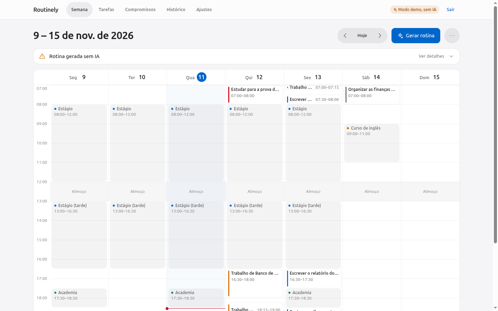
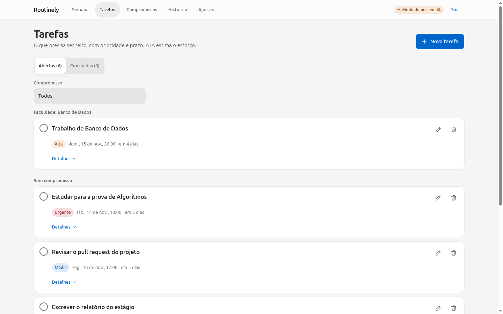
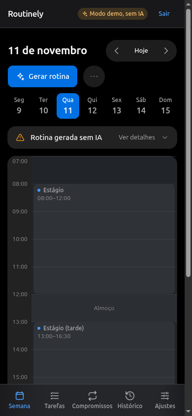
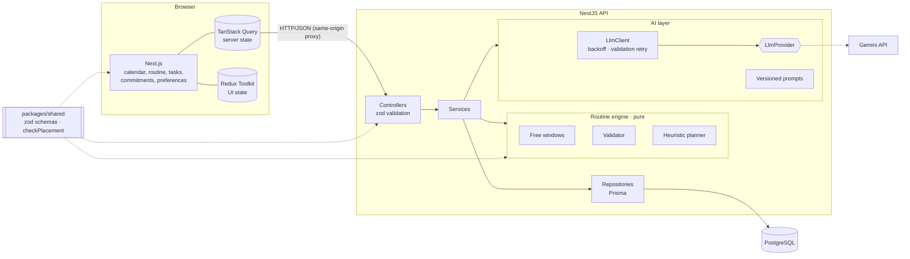
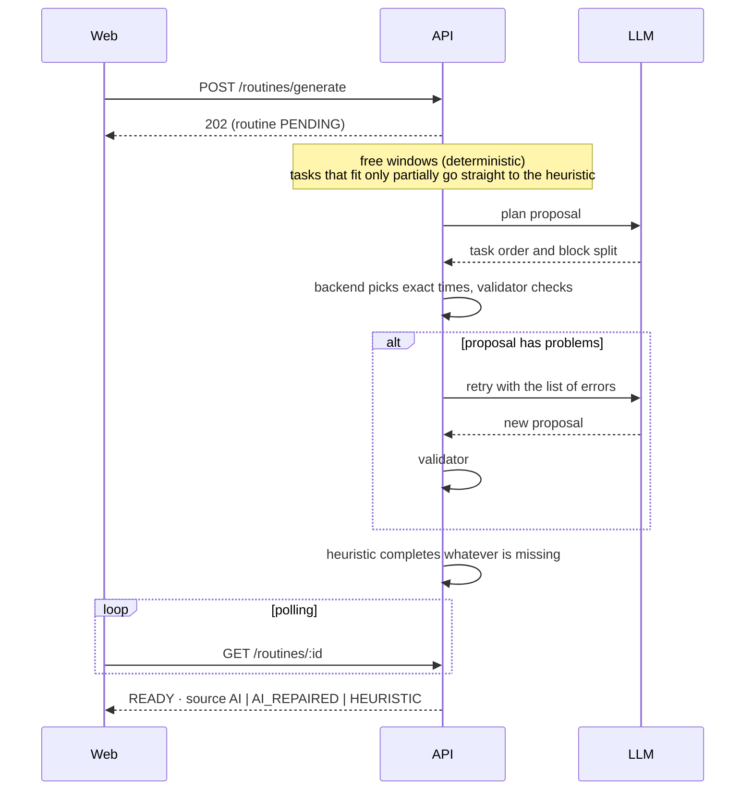

# Routinely

[](https://github.com/Samuel-Davi/app-rotina-AI/actions/workflows/ci.yml)
[](LICENSE)

**English** · [Português](README.pt-BR.md)

Routinely builds a **weekly routine with AI** from your fixed commitments and your tasks (priority and deadline). The AI proposes a plan; a deterministic validator decides what is saved; a heuristic planner guarantees there is always a routine, even when the AI is unavailable.

<p align="center">
  
</p>

## Highlights

- **Fixed commitments and tasks** with **AI effort estimation** (complexity, duration, splittable or not) and manual override.
- **Generate routine**: tasks are placed in free slots respecting the daily window, lunch break, maximum focus block, minimum gap between blocks, travel time and deadlines. When a task does not fit entirely (for example it needs 8 h and only 6 h are free), it is **scheduled with the time that fits and flagged**, never silently dropped. Tasks of the same priority share scarce time fairly.
- **Weekly calendar** (daily view with swipe on mobile) with **drag and drop** to move and resize blocks, validated against conflicts in real time.
- **Replan** only the future, preserving locked and completed blocks.
- **Version history** with a change summary and restore.
- **Accounts**: email and password, per-user data isolation, daily AI quotas, and an optional **portfolio mode** (closed signup plus a shared demo account that never calls the AI).

> **The AI proposes; the backend validates.** No allocation is stored without passing a deterministic validator. If the AI fails (invalid response, rate limit, no key), a heuristic planner still produces a routine, and the UI says so ("Routine generated without AI").

<table>
  <tr>
    <td></td>
    <td></td>
  </tr>
</table>

## Tech stack

| Layer    | Technologies                                                                                      |
| -------- | ------------------------------------------------------------------------------------------------- |
| Web      | Next.js 16 (App Router), React 19, Tailwind CSS 4, TanStack Query, Redux Toolkit, dnd-kit, motion |
| API      | NestJS 11, Prisma 6, PostgreSQL 16, pino, Swagger                                                 |
| AI       | Google Gemini (`@google/genai`) behind a provider interface, structured output validated with zod |
| Shared   | zod 4 schemas used by the API, the forms and the AI output; time utilities with time zones        |
| Quality  | TypeScript strict, ESLint, Prettier, Vitest, Jest, supertest, MSW, Testing Library                |
| Delivery | Docker (multi-stage), Docker Compose, GitHub Actions (CI and CD), Vercel, Render, Supabase        |

## Quick start

Requirements: Docker and Docker Compose.

```bash
cp .env.example .env
# set JWT_SECRET (required) and, optionally, GEMINI_API_KEY (without it the app runs without AI)
echo "JWT_SECRET=$(openssl rand -base64 48)" >> .env
docker compose up --build
```

| Service | URL                        |
| ------- | -------------------------- |
| Web     | http://localhost:3000      |
| API     | http://localhost:3001      |
| Swagger | http://localhost:3001/docs |

A one-shot `migrate` service applies the migrations and the seed before the API starts. Create your account on the sign-up screen. A free Gemini key (no billing) is available at https://aistudio.google.com/apikey.

### Local development (without Docker for the apps)

Requirements: Node 24 and pnpm 12.

```bash
pnpm install
cp .env.example .env
pnpm db:up                                   # PostgreSQL only, via Docker
pnpm --filter @routinely/api prisma:deploy   # migrations
pnpm --filter @routinely/api prisma:seed     # sample data
pnpm dev                                     # web (3000) + api (3001) with hot reload
```

If you already had data from before login existed, claim it with `pnpm --filter @routinely/api claim-owner -- --email you@example.com` (the password is prompted without echo).

### Scripts

| Script               | What it does                                                       |
| -------------------- | ------------------------------------------------------------------ |
| `pnpm dev`           | Runs web and API in development mode                               |
| `pnpm build`         | Builds `shared`, the API and the web app                           |
| `pnpm lint`          | ESLint and Prettier check                                          |
| `pnpm typecheck`     | `tsc --noEmit` in every package                                    |
| `pnpm test`          | Vitest (`shared`, `web`) and Jest unit tests (`api`)               |
| `pnpm test:e2e`      | API end-to-end tests with supertest (needs Postgres: `pnpm db:up`) |
| `pnpm eval:ai`       | Compares planning strategies with a real key (not part of CI)      |
| `pnpm demo:reset`    | Creates or restores the shared demo account                        |
| `pnpm check:secrets` | Scans the web bundle, the API build and tracked files for secrets  |

## Architecture

```
apps/web         Next.js (App Router) + Tailwind + TanStack Query + Redux Toolkit + dnd-kit
apps/api         NestJS + Prisma (PostgreSQL) + isolated AI layer
packages/shared  zod schemas, types, enums and scheduling rules shared by all
docs/            architecture decision records, deploy guide, design notes
```



### How a routine is generated



The validator rejects any block that overlaps a fixed commitment, lunch or another block, leaves the daily window, passes the deadline, exceeds the maximum block, breaks the minimum gap, splits a non-splittable task or allocates a total different from the estimate. The validator and the heuristic are pure functions with 100% coverage, including a property-based test that feeds random "AI" answers and checks every rule on the result.

### Design decisions worth knowing

- **Server state vs UI state.** TanStack Query holds everything that comes from the API (including polling of AI jobs and optimistic updates with rollback); Redux Toolkit holds only UI state (selected week, view mode, filters, drag state, panels, drafts).
- **One source of truth for contracts.** zod schemas in `packages/shared` define DTOs, form validation and the AI output.
- **Provider isolation.** `LlmProvider` is the only contact point with an LLM vendor. `LlmClient` adds exponential backoff with jitter for rate limits and overloaded responses, plus one validation retry on a stronger model. Anthropic and Ollama providers are documented stubs.
- **First-party cookies.** The browser only talks to the web origin; a runtime proxy forwards `/api/*` to the API, so session cookies are `httpOnly; Secure; SameSite=Lax` without CORS tricks.
- **Planning strategy chosen by measurement.** See ADR-021 for the evaluation and its limits.

Every decision is recorded in [`docs/DECISIONS.md`](docs/DECISIONS.md) (in Portuguese).

## Configuration

All variables are documented in [`.env.example`](.env.example). The main ones:

| Variable                | Default                 | Description                                                               |
| ----------------------- | ----------------------- | ------------------------------------------------------------------------- |
| `JWT_SECRET`            | —                       | Token signing secret, at least 32 characters (required in production)     |
| `LLM_PROVIDER`          | `gemini`                | `gemini`, `anthropic` or `ollama`                                         |
| `GEMINI_API_KEY`        | —                       | Google AI Studio key (optional: without it the heuristic planner is used) |
| `GEMINI_MODEL`          | `gemini-3.5-flash-lite` | Default model                                                             |
| `GEMINI_RETRY_MODEL`    | `gemini-3.6-flash`      | Model used for the validation retry                                       |
| `AI_PLANNING_STRATEGY`  | `order-day`             | `times`, `order` or `order-day`                                           |
| `AI_DAILY_LIMIT`        | `40`                    | AI uses per user per UTC day                                              |
| `AI_GLOBAL_DAILY_LIMIT` | `200`                   | AI uses across all users per UTC day                                      |
| `REGISTRATION_ENABLED`  | `true` (dev)            | Set to `false` to close sign-up (portfolio mode)                          |
| `DEMO_ENABLED`          | `false`                 | Enables the shared demo account (never calls the AI)                      |
| `DATABASE_URL`          | local Postgres          | Runtime connection (pooled in production)                                 |
| `DIRECT_URL`            | local Postgres          | Direct connection used by migrations                                      |
| `API_INTERNAL_URL`      | `http://localhost:3001` | Where the web server forwards `/api/*` (read at runtime)                  |
| `NEXT_PUBLIC_API_URL`   | _(empty)_               | **Leave empty**: the browser calls its own origin (`/api/*`)              |

### Using another LLM

`AnthropicProvider` and `OllamaProvider` are stubs: they implement the interface but report "unavailable", and the app falls back to the heuristic planner. To enable one, implement `generateStructured` following the roadmap in the file header, make `isConfigured()` return `true` and set `LLM_PROVIDER`. Retry, backoff, validation and fallback live outside the providers and stay unchanged.

## Testing and quality

- **API (Jest):** services, the AI layer with a fake provider, the routine engine (coverage threshold enforced in `jest.config.ts`) and end-to-end tests against a dedicated database.
- **Web (Vitest, Testing Library, MSW):** calendar, task form, generation and replan flow, resize with rollback, Redux slices and TanStack Query hooks.
- **No test or CI job calls a real LLM.**
- **CI** (`.github/workflows/ci.yml`) runs lint and typecheck, web tests, API tests with a Postgres service, the build, Docker image builds and a secret scan, in parallel, with read-only token permissions and actions pinned by commit SHA.
- **CD** (`.github/workflows/deploy.yml`) deploys only after CI succeeds on `main`: migrations first, then the API and the web app, then a smoke test through the same path a browser uses.

## Deploy

The published setup uses Vercel (web), Render (API) and Supabase (PostgreSQL), all on free tiers. See [`docs/DEPLOY.md`](docs/DEPLOY.md) (in Portuguese) for the architecture, the environment variables, rollback and free-tier limits.

## Known limitations

- Background AI jobs run in the API process (state in the database, polling on the client). Several API instances would need a persistent queue.
- Authentication is intentionally basic: no email verification, password recovery or OAuth. Rate limiting is per instance.
- Drag and drop on touch screens was tested with emulation, not on physical devices.
- Anthropic and Ollama providers are stubs.

## Documentation

- [`docs/DECISIONS.md`](docs/DECISIONS.md): architecture decision records
- [`docs/DEPLOY.md`](docs/DEPLOY.md): CI, CD and portfolio mode
- [`docs/SUPABASE.md`](docs/SUPABASE.md): using Supabase as the database
- [`docs/DESIGN-NOTES.md`](docs/DESIGN-NOTES.md): interface redesign and accessibility measurements

## License

[MIT](LICENSE)
