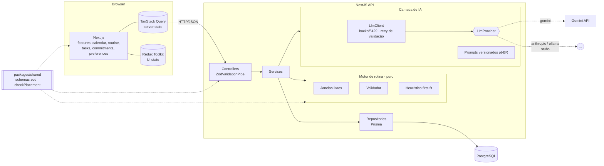
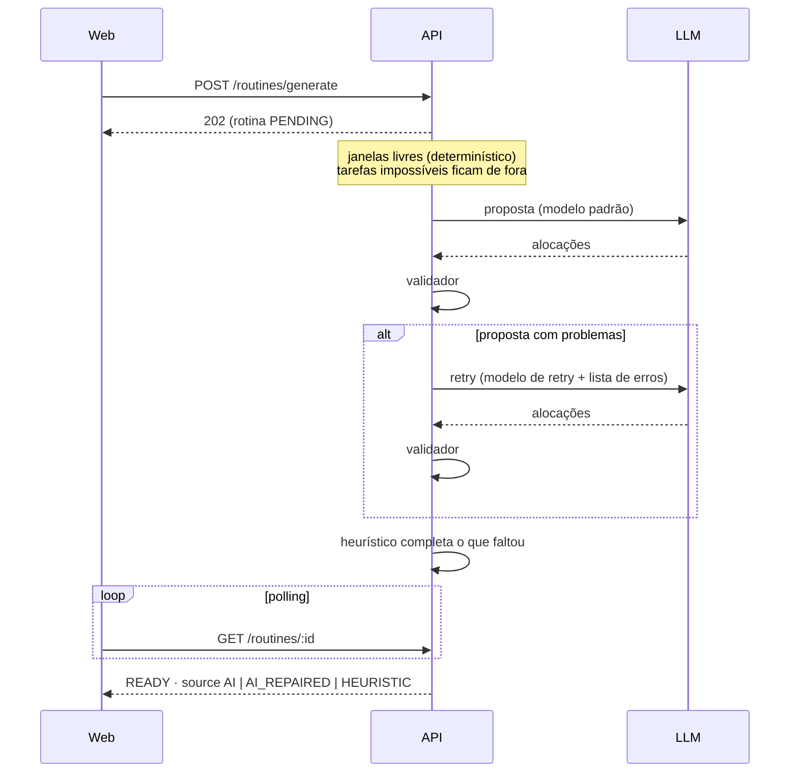

# Routinely

Gera, com IA, uma **rotina semanal** a partir dos seus compromissos fixos e das suas tarefas com prioridade e prazo.

- Compromissos fixos semanais e tarefas (CRUD), com **estimativa de esforço por IA** (complexidade, duração, divisível) e ajuste manual.
- **Gerar rotina**: as tarefas são distribuídas nos horários livres, respeitando janela diária, almoço, bloco máximo de foco, intervalo entre blocos e prazos.
- Calendário semanal (visão diária com swipe no celular), **drag & drop** para mover/redimensionar com validação de conflito em tempo real.
- **Replanejar** só o futuro, preservando blocos travados e concluídos; sugestão automática quando a rotina fica desatualizada.
- Concluir blocos/tarefas e **histórico de versões** com diff resumido e restauração.

> **A IA propõe; o backend valida.** Nenhuma alocação é salva sem passar por um validador determinístico. Se a IA falhar (resposta inválida, limite de uso, sem chave), um planejador heurístico garante que sempre exista uma rotina — e a interface avisa: _"Rotina gerada sem IA"_.

## Começando

Pré-requisitos: Docker + Docker Compose.

```bash
cp .env.example .env
# edite .env e preencha GEMINI_API_KEY (opcional: sem chave o app funciona sem IA)
docker compose up --build
```

| Serviço | URL                        |
| ------- | -------------------------- |
| Web     | http://localhost:3000      |
| API     | http://localhost:3001      |
| Swagger | http://localhost:3001/docs |

Na subida, o serviço `migrate` (um job que roda e sai) aplica as migrations e carrega o seed (usuário único, preferências e exemplos de compromissos e tarefas); a API só inicia depois que ele termina com sucesso.

A chave do Gemini é gratuita (sem billing): https://aistudio.google.com/apikey.

### Primeiro acesso (login)

A API exige login. Defina um segredo para os tokens no `.env` e, se você já tinha dados de antes do login, reivindique-os:

```bash
# 1. segredo dos tokens (obrigatório com docker compose / produção)
echo "JWT_SECRET=$(openssl rand -base64 48)" >> .env

# 2. (só se já havia dados) define e-mail e senha do dono dos dados atuais; a senha é pedida
#    no terminal, sem eco
docker compose run --rm -it migrate node scripts/claim-owner.mjs --email voce@exemplo.com
#    sem Docker: pnpm --filter @routinely/api claim-owner -- --email voce@exemplo.com
```

Quem começa do zero apenas cria a conta na tela de cadastro (sem verificação de e-mail e sem OAuth no MVP).

### Desenvolvimento local (sem Docker para os apps)

Pré-requisitos: Node 24 e pnpm 12.

```bash
pnpm install
cp .env.example .env
pnpm db:up                                   # só o Postgres, via Docker
pnpm --filter @routinely/api prisma:deploy   # migrations
pnpm --filter @routinely/api prisma:seed     # dados de exemplo
pnpm dev                                     # web (3000) + api (3001) com hot reload
```

Ou, com hot reload dentro do Docker:

```bash
docker compose -f docker-compose.yml -f docker-compose.dev.yml up --build
```

## Scripts

Na raiz do monorepo:

| Script           | O que faz                                                         |
| ---------------- | ----------------------------------------------------------------- |
| `pnpm dev`       | Sobe web e API em modo desenvolvimento                            |
| `pnpm build`     | Compila `shared`, API e web                                       |
| `pnpm lint`      | ESLint (API/shared + web) e verificação do Prettier               |
| `pnpm typecheck` | `tsc --noEmit` em todos os pacotes                                |
| `pnpm test`      | Vitest (`shared`, `web`) e Jest unitário (`api`)                  |
| `pnpm test:e2e`  | Jest e2e da API com supertest (precisa do Postgres: `pnpm db:up`) |
| `pnpm format`    | Formata tudo com Prettier                                         |
| `pnpm db:up`     | Sobe apenas o Postgres do compose                                 |

Na API (`pnpm --filter @routinely/api <script>`): `prisma:migrate`, `prisma:deploy`, `prisma:seed`, `test:cov`.

## Arquitetura

Monorepo com pnpm workspaces:

```
apps/web         Next.js (App Router) + Tailwind + TanStack Query + Redux Toolkit + dnd-kit
apps/api         NestJS + Prisma (PostgreSQL) + camada de IA isolada
packages/shared  schemas zod, tipos, enums e regras de horário compartilhadas
docs/            decisões (ADRs) e guia do Supabase
```



### Como uma rotina é gerada



O validador rejeita qualquer bloco que sobreponha compromisso fixo, almoço ou outro bloco, saia da janela diária, passe do prazo, exceda o bloco máximo, desrespeite o intervalo mínimo, divida uma tarefa indivisível ou aloque um total diferente do estimado. Ele e o heurístico são funções puras com 100% de cobertura, incluindo um teste de propriedade com respostas aleatórias da "IA".

### Estado no front

- **TanStack Query** guarda todo o _server state_: listas, rotina ativa, polling dos jobs de IA e _optimistic updates_ com rollback (drag & drop, concluir, excluir).
- **Redux Toolkit** guarda apenas _UI state_: semana/dia selecionado, modo de visão, filtros, estado do arrasto, painéis abertos e rascunhos de formulário.

### Camada de IA

- Interface `LlmProvider { generateStructured<T>(input): Promise<T> }` em `apps/api/src/ai`.
- `GeminiProvider` (`@google/genai`): saída estruturada com `responseMimeType: application/json` + `responseJsonSchema` gerado dos schemas zod, seguida de `zod.parse`.
- `LlmClient`: backoff exponencial com jitter para 429 (até `LLM_MAX_ATTEMPTS`) e **um** retry no modelo de retry quando a validação falha.
- Dois casos de uso: `estimateTask` (com cache por hash de título+descrição+prioridade) e `generateRoutine`.
- Prompts versionados em `apps/api/src/ai/prompts/*.md`. A chave de API nunca é logada.

## Configuração

Todas as variáveis estão documentadas em [`.env.example`](.env.example). As principais:

| Variável              | Padrão                  | Descrição                                                        |
| --------------------- | ----------------------- | ---------------------------------------------------------------- |
| `LLM_PROVIDER`        | `gemini`                | `gemini`, `anthropic` ou `ollama`                                |
| `GEMINI_API_KEY`      | —                       | Chave do Google AI Studio                                        |
| `GEMINI_MODEL`        | `gemini-3.5-flash-lite` | Modelo padrão                                                    |
| `GEMINI_RETRY_MODEL`  | `gemini-3.6-flash`      | Modelo usado no retry de validação                               |
| `DATABASE_URL`        | Postgres local          | Conexão usada em runtime (pooled em produção)                    |
| `DIRECT_URL`          | Postgres local          | Conexão direta usada pelas migrations                            |
| `NEXT_PUBLIC_API_URL` | `http://localhost:3001` | URL da API vista pelo navegador (embutida no build do front)     |
| `DEFAULT_TIMEZONE`    | `America/Manaus`        | Fuso padrão (cada usuário pode trocar em Ajustes)                |
| `CORS_ORIGINS`        | `http://localhost:3000` | Origens permitidas, separadas por vírgula                        |
| `LLM_TIMEOUT_MS`      | `30000`                 | Timeout por chamada de IA                                        |
| `AI_RATE_LIMIT_MAX`   | `20`                    | Requisições por `AI_RATE_LIMIT_TTL_MS` nos endpoints que usam IA |

### Trocar para o Supabase

O `schema.prisma` já usa `url = env("DATABASE_URL")` (pooled) e `directUrl = env("DIRECT_URL")`. Basta apontar as duas variáveis para o seu projeto e aplicar as migrations. Passo a passo em [`docs/SUPABASE.md`](docs/SUPABASE.md).

### Trocar para um LLM local (Ollama) ou Anthropic

A seleção é feita por `LLM_PROVIDER`. `AnthropicProvider` e `OllamaProvider` são **stubs documentados**: implementam a interface, mas respondem "indisponível", e o app cai no heurístico. Para ativar um deles:

1. Implemente `generateStructured` em `apps/api/src/ai/providers/ollama.provider.ts` (ou `anthropic.provider.ts`) seguindo o roteiro no comentário do arquivo — para o Ollama é um `POST {OLLAMA_BASE_URL}/api/chat` com `format` = JSON Schema e `parseStructured` na resposta.
2. Faça `isConfigured()` retornar `true`.
3. Defina `LLM_PROVIDER=ollama`, `OLLAMA_BASE_URL` e `OLLAMA_MODEL` no `.env` (no Docker, adicione um serviço `ollama` ao compose e use `http://ollama:11434`).

Nada mais muda: retry, backoff, validação e fallback ficam no `LlmClient` e no motor de rotina.

## Testes

- **API (Jest)**: services, camada de IA com `LlmProvider` mockado, motor de rotina (cobertura mínima exigida no `jest.config.ts`) e e2e dos endpoints com um banco de teste (`routinely_test`).
- **Web (Vitest + Testing Library + MSW)**: calendário, card e formulário de tarefa, fluxo de geração/replanejamento, redimensionamento com rollback, slices/selectors Redux e hooks do TanStack Query.
- Nenhum teste chama um LLM real.

## CI

`.github/workflows/ci.yml` roda em push/PR, com jobs em paralelo: lint + typecheck, testes web, testes API (com serviço Postgres), build e build das imagens Docker (sem push). Runs antigos do mesmo branch são cancelados e o token tem permissão somente de leitura.

## Documentação

- [`docs/DECISIONS.md`](docs/DECISIONS.md) — decisões de arquitetura (ADRs), pendências e riscos conhecidos.
- [`docs/SUPABASE.md`](docs/SUPABASE.md) — como usar o Supabase como banco.
