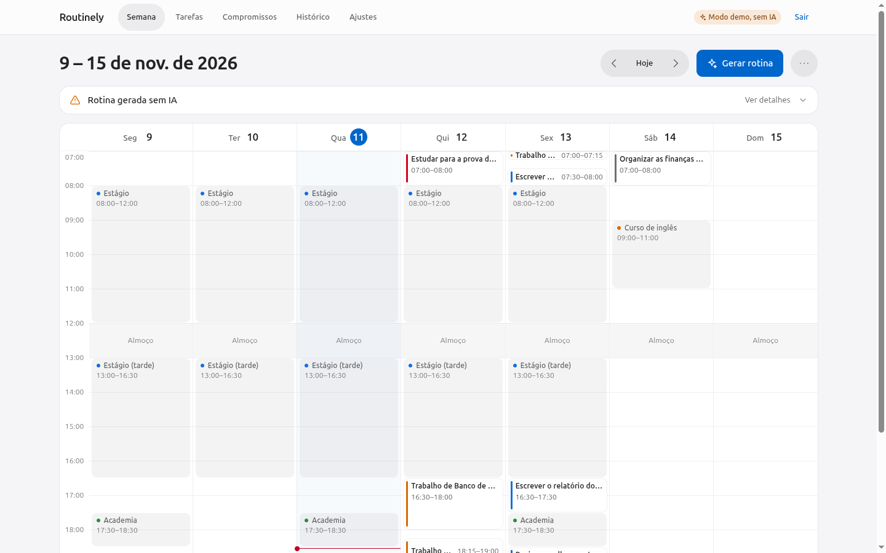
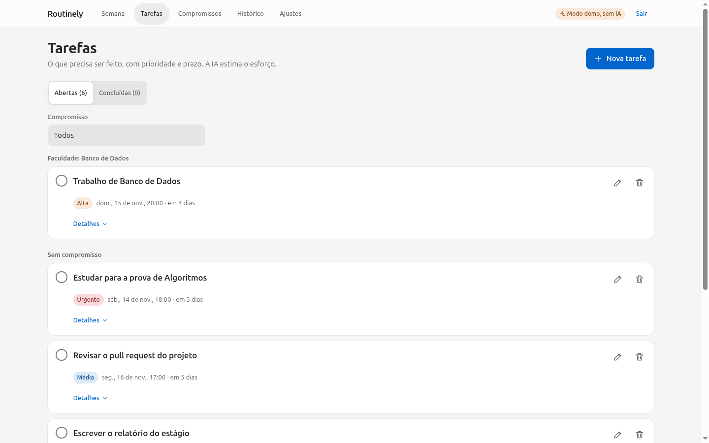
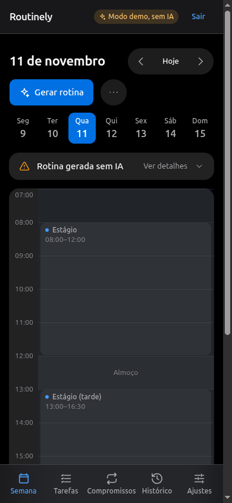
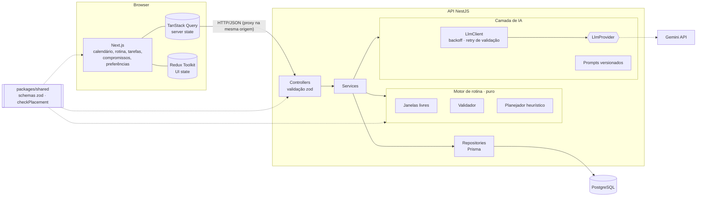
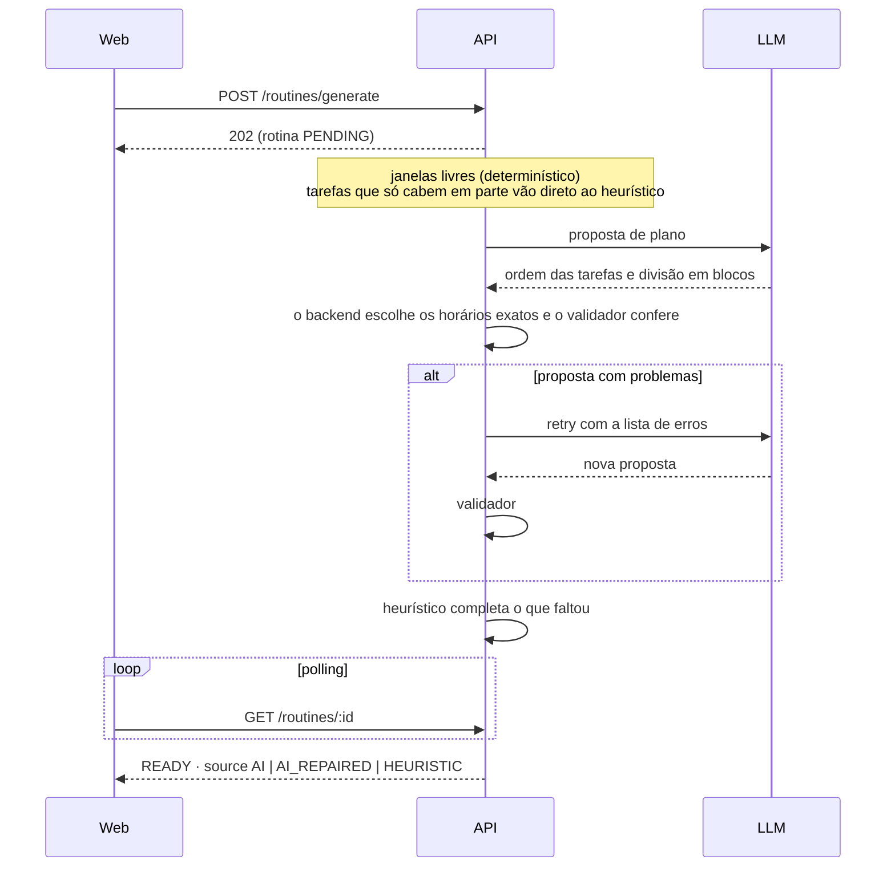

# Routinely

[](https://github.com/Samuel-Davi/app-rotina-AI/actions/workflows/ci.yml)
[](LICENSE)

[English](README.md) · **Português**

O Routinely monta uma **rotina semanal com IA** a partir dos seus compromissos fixos e das suas tarefas (prioridade e prazo). A IA propõe o plano; um validador determinístico decide o que é salvo; um planejador heurístico garante que sempre exista uma rotina, mesmo quando a IA não está disponível.

<p align="center">
  
</p>

## Destaques

- **Compromissos fixos e tarefas** com **estimativa de esforço por IA** (complexidade, duração, divisível ou não) e ajuste manual.
- **Gerar rotina**: as tarefas são distribuídas nos horários livres, respeitando janela diária, almoço, bloco máximo de foco, intervalo entre blocos, deslocamento e prazos. Se uma tarefa não cabe inteira (por exemplo, precisa de 8 h e só há 6 h), ela é **alocada com o que couber e sinalizada**, nunca descartada em silêncio. Tarefas de mesma prioridade dividem o tempo escasso de forma justa.
- **Calendário semanal** (visão diária com swipe no celular) com **drag and drop** para mover e redimensionar blocos, validado contra conflitos em tempo real.
- **Replanejar** só o futuro, preservando blocos travados e concluídos.
- **Histórico de versões** com resumo das mudanças e restauração.
- **Contas**: e-mail e senha, isolamento de dados por usuário, cotas diárias de IA e um **modo portfólio** opcional (cadastro fechado e uma conta demo compartilhada que nunca chama a IA).

> **A IA propõe; o backend valida.** Nenhuma alocação é salva sem passar por um validador determinístico. Se a IA falhar (resposta inválida, limite de uso, sem chave), um planejador heurístico ainda gera a rotina e a interface avisa ("Rotina gerada sem IA").

<table>
  <tr>
    <td></td>
    <td></td>
  </tr>
</table>

## Stack

| Camada        | Tecnologias                                                                                            |
| ------------- | ------------------------------------------------------------------------------------------------------ |
| Web           | Next.js 16 (App Router), React 19, Tailwind CSS 4, TanStack Query, Redux Toolkit, dnd-kit, motion      |
| API           | NestJS 11, Prisma 6, PostgreSQL 16, pino, Swagger                                                      |
| IA            | Google Gemini (`@google/genai`) atrás de uma interface de provedor, saída estruturada validada com zod |
| Compartilhado | Schemas zod usados pela API, pelos formulários e pela saída da IA; utilitários de tempo com fuso       |
| Qualidade     | TypeScript strict, ESLint, Prettier, Vitest, Jest, supertest, MSW, Testing Library                     |
| Entrega       | Docker (multi-stage), Docker Compose, GitHub Actions (CI e CD), Vercel, Render, Supabase               |

## Começando

Pré-requisitos: Docker e Docker Compose.

```bash
cp .env.example .env
# defina JWT_SECRET (obrigatório) e, opcionalmente, GEMINI_API_KEY (sem chave o app funciona sem IA)
echo "JWT_SECRET=$(openssl rand -base64 48)" >> .env
docker compose up --build
```

| Serviço | URL                        |
| ------- | -------------------------- |
| Web     | http://localhost:3000      |
| API     | http://localhost:3001      |
| Swagger | http://localhost:3001/docs |

Um serviço `migrate` (que roda e sai) aplica as migrations e o seed antes de a API iniciar. Crie a sua conta na tela de cadastro. Uma chave gratuita do Gemini (sem billing) está em https://aistudio.google.com/apikey.

### Desenvolvimento local (sem Docker para os apps)

Pré-requisitos: Node 24 e pnpm 12.

```bash
pnpm install
cp .env.example .env
pnpm db:up                                   # só o PostgreSQL, via Docker
pnpm --filter @routinely/api prisma:deploy   # migrations
pnpm --filter @routinely/api prisma:seed     # dados de exemplo
pnpm dev                                     # web (3000) + api (3001) com hot reload
```

Se você já tinha dados de antes do login existir, reivindique-os com `pnpm --filter @routinely/api claim-owner -- --email voce@exemplo.com` (a senha é pedida sem eco).

### Scripts

| Script               | O que faz                                                         |
| -------------------- | ----------------------------------------------------------------- |
| `pnpm dev`           | Sobe web e API em modo desenvolvimento                            |
| `pnpm build`         | Compila `shared`, API e web                                       |
| `pnpm lint`          | ESLint e verificação do Prettier                                  |
| `pnpm typecheck`     | `tsc --noEmit` em todos os pacotes                                |
| `pnpm test`          | Vitest (`shared`, `web`) e Jest unitário (`api`)                  |
| `pnpm test:e2e`      | Jest e2e da API com supertest (precisa do Postgres: `pnpm db:up`) |
| `pnpm eval:ai`       | Compara estratégias de planejamento com chave real (fora do CI)   |
| `pnpm demo:reset`    | Cria ou restaura a conta demo compartilhada                       |
| `pnpm check:secrets` | Varre o bundle do front, o build da API e os arquivos versionados |

## Arquitetura

```
apps/web         Next.js (App Router) + Tailwind + TanStack Query + Redux Toolkit + dnd-kit
apps/api         NestJS + Prisma (PostgreSQL) + camada de IA isolada
packages/shared  schemas zod, tipos, enums e regras de horário compartilhados
docs/            decisões de arquitetura (ADRs), guia de deploy, notas de design
```



### Como uma rotina é gerada



O validador rejeita qualquer bloco que sobreponha compromisso fixo, almoço ou outro bloco, saia da janela diária, passe do prazo, exceda o bloco máximo, desrespeite o intervalo mínimo, divida uma tarefa indivisível ou aloque um total diferente do estimado. Ele e o heurístico são funções puras com 100% de cobertura, incluindo um teste de propriedade que alimenta respostas aleatórias da "IA" e confere todas as regras no resultado.

### Decisões de projeto que vale conhecer

- **Server state × UI state.** O TanStack Query guarda tudo que vem da API (inclusive o polling dos jobs de IA e _optimistic updates_ com rollback); o Redux Toolkit guarda só estado de interface (semana selecionada, modo de visão, filtros, arrasto, painéis, rascunhos).
- **Uma fonte de verdade para contratos.** Os schemas zod de `packages/shared` definem DTOs, validação de formulários e a saída da IA.
- **Isolamento do provedor.** `LlmProvider` é o único ponto de contato com um fornecedor de LLM. O `LlmClient` adiciona backoff exponencial com jitter para limite de uso e sobrecarga, além de um retry de validação em um modelo mais forte. Os provedores Anthropic e Ollama são stubs documentados.
- **Cookies first-party.** O navegador só fala com a origem do front; um proxy em runtime encaminha `/api/*` para a API, então os cookies de sessão são `httpOnly; Secure; SameSite=Lax` sem malabarismo de CORS.
- **Estratégia de planejamento escolhida por medição.** Veja o ADR-021 para a avaliação e seus limites.

Todas as decisões estão registradas em [`docs/DECISIONS.md`](docs/DECISIONS.md).

## Configuração

Todas as variáveis estão documentadas em [`.env.example`](.env.example). As principais:

| Variável                | Padrão                  | Descrição                                                                           |
| ----------------------- | ----------------------- | ----------------------------------------------------------------------------------- |
| `JWT_SECRET`            | —                       | Segredo de assinatura dos tokens, mínimo de 32 caracteres (obrigatório em produção) |
| `LLM_PROVIDER`          | `gemini`                | `gemini`, `anthropic` ou `ollama`                                                   |
| `GEMINI_API_KEY`        | —                       | Chave do Google AI Studio (opcional: sem ela vale o planejador heurístico)          |
| `GEMINI_MODEL`          | `gemini-3.5-flash-lite` | Modelo padrão                                                                       |
| `GEMINI_RETRY_MODEL`    | `gemini-3.6-flash`      | Modelo usado no retry de validação                                                  |
| `AI_PLANNING_STRATEGY`  | `order-day`             | `times`, `order` ou `order-day`                                                     |
| `AI_DAILY_LIMIT`        | `40`                    | Usos de IA por usuário por dia UTC                                                  |
| `AI_GLOBAL_DAILY_LIMIT` | `200`                   | Usos de IA somando todos os usuários por dia UTC                                    |
| `REGISTRATION_ENABLED`  | `true` (dev)            | `false` fecha o cadastro (modo portfólio)                                           |
| `DEMO_ENABLED`          | `false`                 | Ativa a conta demo compartilhada (nunca chama a IA)                                 |
| `DATABASE_URL`          | Postgres local          | Conexão de runtime (pooled em produção)                                             |
| `DIRECT_URL`            | Postgres local          | Conexão direta usada pelas migrations                                               |
| `API_INTERNAL_URL`      | `http://localhost:3001` | Para onde o servidor web encaminha `/api/*` (lido em runtime)                       |
| `NEXT_PUBLIC_API_URL`   | _(vazio)_               | **Deixe vazio**: o navegador chama a própria origem (`/api/*`)                      |

### Usando outro LLM

`AnthropicProvider` e `OllamaProvider` são stubs: implementam a interface, mas respondem "indisponível", e o app cai no planejador heurístico. Para ativar um deles, implemente `generateStructured` seguindo o roteiro no cabeçalho do arquivo, faça `isConfigured()` retornar `true` e defina `LLM_PROVIDER`. Retry, backoff, validação e fallback ficam fora dos provedores e não mudam.

## Testes e qualidade

- **API (Jest):** services, camada de IA com provedor falso, motor de rotina (cobertura mínima exigida no `jest.config.ts`) e testes e2e com um banco dedicado.
- **Web (Vitest, Testing Library, MSW):** calendário, formulário de tarefa, fluxo de geração e replanejamento, redimensionamento com rollback, slices Redux e hooks do TanStack Query.
- **Nenhum teste ou job de CI chama um LLM real.**
- **CI** (`.github/workflows/ci.yml`): lint e typecheck, testes web, testes da API com serviço Postgres, build, build das imagens Docker e varredura de segredos, em paralelo, com token somente leitura e ações fixadas por SHA.
- **CD** (`.github/workflows/deploy.yml`): só publica depois que o CI passa na `main`: migrations primeiro, depois API e web, e por fim um smoke test pelo mesmo caminho que o navegador usa.

## Deploy

A publicação usa Vercel (web), Render (API) e Supabase (PostgreSQL), todos em planos gratuitos. Veja [`docs/DEPLOY.md`](docs/DEPLOY.md) para a arquitetura, as variáveis de ambiente, o rollback e os limites dos planos.

## Limitações conhecidas

- Os jobs de IA rodam no processo da API (estado no banco, polling no cliente). Várias instâncias exigiriam uma fila persistente.
- A autenticação é básica de propósito: sem verificação de e-mail, recuperação de senha ou OAuth. O rate limit é por instância.
- O arrasto por toque foi testado em emulação, não em aparelhos físicos.
- Os provedores Anthropic e Ollama são stubs.

## Documentação

- [`docs/DECISIONS.md`](docs/DECISIONS.md): registros de decisões de arquitetura
- [`docs/DEPLOY.md`](docs/DEPLOY.md): CI, CD e modo portfólio
- [`docs/SUPABASE.md`](docs/SUPABASE.md): usando o Supabase como banco
- [`docs/DESIGN-NOTES.md`](docs/DESIGN-NOTES.md): redesign da interface e medições de acessibilidade

## Licença

[MIT](LICENSE)
